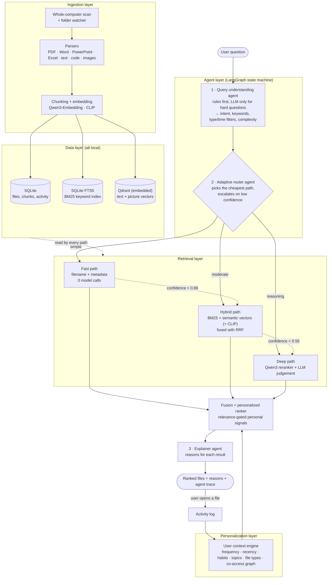

# 🗂️ Agentic AI-based Intelligent File Recommendation System

**Ask for a file the way you'd ask a colleague** ("the pricing deck I worked on last week", "my resume",
"photo of a group of people") and get the right file, with a short explanation of *why* it was recommended.

A local, fully open-source file assistant that:

- **finds files** by name, metadata, keywords, meaning and even picture content;
- **learns each user's habits**: what they open often, when, which file types, which files go together;
- **decides per question how much effort to spend**: an agentic router picks the cheapest search
  strategy that can answer confidently, and escalates only when needed.

Everything runs on a normal Windows laptop **without a GPU**. No file ever leaves the computer.


---

## Contents

- [The problem](#the-problem)
- [What the system does](#what-the-system-does)
- [Architecture](#architecture)
- [How a question is answered](#how-a-question-is-answered)
- [Personalization](#personalization)
- [Tech stack and models](#tech-stack-and-models)
- [Project structure](#project-structure)
- [Setup (Windows)](#setup-windows)
- [Running it](#running-it)
- [Example questions](#example-questions)
- [Evaluation](#evaluation)
- [Configuration](#configuration)
- [Limitations and future work](#limitations-and-future-work)

---

## The problem

People keep thousands of files spread across drives and folders, with names like `final_FINAL_v2.docx`
or `notes_0912.md`. Windows search matches file names, so it fails when you remember *what a file is
about* or *when you used it*, but not its name. And treating every question the same way is wasteful:
`Q3_rates_v4.pptx` needs a filename lookup, while "why did we drop kafka" needs a model to read the
content.

The project has three objectives:

1. **Intelligent file discovery and recommendation**: filename, metadata, keyword, semantic and hybrid
   search, with an explanation for every result.
2. **Personalized recommendation from user context**: frequently used files, work patterns, preferred
   file types, topics and time-of-week habits.
3. **Agentic query optimization and routing**: estimate how hard each question is and choose the
   cheapest combination of metadata, keyword, semantic, reranking and LLM methods that answers it,
   keeping computation and latency low.

## What the system does

| Capability | How |
| --- | --- |
| Find by name, even misspelled | RapidFuzz fuzzy filename matching over a cached name index |
| Find by type and date ("pdfs from last month") | Rule-based query parsing + SQLite metadata filters |
| Find by content ("document that talks about file recommendation") | BM25 keyword search (SQLite FTS5) + semantic vectors (Qwen3-Embedding) fused with RRF |
| Find by a sentence from inside a document | The same hybrid search over the indexed text |
| Answer reasoning questions ("why did we drop kafka") | Qwen3-Reranker + a small local LLM judging the top candidates |
| Find pictures by what they show ("photo of a beach") | CLIP image embeddings, with thumbnails in the results |
| Personalize per user | Frequency, recency, weekday/hour habits, topics, file types, co-access graph |
| Explain every result | Reasons built from the signals that produced the score ("You opened it 6 times", "Mentions \"budget\"") |
| Search the whole laptop | Two-tier indexing: names and dates of every document in minutes, contents in the background |
| Stay current | Folder watcher re-indexes files as they change; Windows "Recent files" import gives day-one history |

## Architecture



**Five layers, three agents.** Ingestion → data stores → retrieval → personalization → agents/UI. The
three agents are the **query understanding agent**, the **adaptive router agent** and the **explainer
agent**, coordinated as a LangGraph state machine. Each step writes to a visible **agent trace** in the
UI: time taken, model calls and the reason for each decision.

## How a question is answered

| Path | Used for | What runs | Typical time on a CPU laptop |
| --- | --- | --- | --- |
| **Fast** | File names, types, dates (`Q3_rates_v4.pptx`, `pdfs from last month`, `my resume`) | SQLite filters + fuzzy filename match | well under a second, **0 model calls** |
| **Hybrid** | Content and topic questions (`notes about machine learning`, `photo of a beach`) | BM25 + semantic search (+ CLIP for pictures), Reciprocal Rank Fusion (k = 60) | a few seconds |
| **Deep** | Reasoning questions (`why did we drop kafka`, `compare my two resumes`) | Hybrid candidates → Qwen3-Reranker on the top 6 → LLM judges the top 3 | 20–40 seconds |

**Routing logic.** The query understanding agent computes a complexity score from the question
(filename present, reasoning words such as *why / compare / decision*, number of content keywords).
Low complexity starts at the fast path, high complexity at the deep path. After each path the router
checks a confidence score and **escalates only if needed** (fast → hybrid below 0.86, hybrid → deep
below 0.55). It also skips the deep path when the filters leave five files or fewer, and relaxes a
filter that matches no files instead of returning nothing. The LLM is used for parsing only when the
question is reasoning-heavy, so simple questions never pay for a model call.

## Personalization

Each result's score combines relevance with the user's own signals:

```
score = 0.75 · R  +  R³ · Σ wᵢ · sᵢ
```

`R` is relevance from retrieval; `sᵢ` are personal signals: decayed frequency (half-life 10 days),
recency, weekday × hour habits, topic similarity to recent work, preferred file types and a co-access
graph (NetworkX) of files used together. The **R³ gate** means personal signals re-order *relevant*
files but cannot push an irrelevant file to the top just because the user opens it a lot. Personal
weights are doubled for first-person questions ("the deck **I** worked on"), and habit weight is
boosted when a weekday is named ("the spreadsheet I check on mondays").

Every **Open** click is logged, so the profile updates immediately and the next search reflects it.

## Tech stack and models

| Layer | Technology |
| --- | --- |
| UI | Streamlit |
| Agent orchestration | LangGraph |
| LLM (query parsing, judgement) | **Qwen3 1.7B** via Ollama, JSON-schema constrained output |
| Text embeddings | **Qwen3-Embedding-0.6B**, truncated to 512 dimensions (Matryoshka) |
| Reranker | **Qwen3-Reranker-0.6B** |
| Picture search | **CLIP ViT-B/32** (`clip-ViT-B-32`, sentence-transformers) |
| Vector store | Qdrant (embedded mode, no server) |
| Keyword search | SQLite FTS5 (BM25) |
| Metadata and activity | SQLite |
| Fuzzy filename matching | RapidFuzz |
| Co-access graph | NetworkX |
| Parsing | pypdf, python-docx, python-pptx, openpyxl (Docling and Tesseract OCR optional) |
| Folder watching | watchdog |

All models are open-weight and run locally on the CPU. Total download is about 3 GB, one time.

## Project structure

```
├── app.py                    Streamlit UI (search, compare paths, user insights)
├── filerec/
│   ├── query_agent.py        Query understanding agent (rules + LLM for hard questions)
│   ├── pipeline.py           Engine + LangGraph router agent (fast / hybrid / deep, escalation)
│   ├── retrieval.py          The three retrieval paths and Reciprocal Rank Fusion
│   ├── ranking.py            Personalized ranker and explainer agent
│   ├── personalization.py    User context engine (habits, topics, co-access graph)
│   ├── models.py             Embedder, reranker, CLIP and Ollama clients
│   ├── store.py              Keyword index (SQLite FTS5) and vector index (Qdrant)
│   ├── indexer.py            File ingestion, chunking, embedding, folder watcher
│   ├── parsers.py            Text extraction per file type
│   ├── system_scan.py        Whole-computer scan, background indexing, Windows Recent import
│   ├── db.py                 SQLite: files, chunks, activity, queries
│   └── config.py             Thresholds, weights and settings
├── scripts/
│   ├── make_demo_corpus.py   Builds the 43-file demo workspace (fictional company)
│   ├── simulate_activity.py  30 days of activity for two demo users
│   ├── evaluate.py           Benchmark: Recall@3, MRR, latency, model calls
│   └── index_folder.py       Index a folder from the command line
├── setup.bat                 One-time setup on Windows
├── run.bat                   Start with the demo index
├── run_mine.bat              Start with an index of folders you choose
└── run_system.bat            Start with the whole-laptop index
```

## Setup (Windows)

1. Install **Python 3.11 or 3.12 (64-bit)** from python.org and tick **Add python.exe to PATH**.
2. Clone the repository and run the setup:
   ```bat
   git clone https://github.com/SHARMI-P/file-recommendation-system.git
   cd file-recommendation-system
   setup.bat
   ```
   This creates a virtual environment, installs CPU PyTorch and all packages, and generates the demo
   workspace.
3. Install **Ollama** from https://ollama.com, then pull the LLM:
   ```bat
   ollama pull qwen3:1.7b
   ```
   The app also works without Ollama (rules-only parsing, no LLM judgement).
4. *(Optional, if drive C: is small)* keep the models on another drive:
   ```bat
   setx OLLAMA_MODELS D:\models\ollama
   setx HF_HOME D:\models\huggingface
   ```

## Running it

There are three separate indexes, so the demo never mixes with your own files:

| Start with | Searches | Index location |
| --- | --- | --- |
| `run.bat` | The demo workspace (fictional company "Nimbus Analytics") | `.filerec_data` |
| `run_mine.bat` | Folders you add with **Index folder** | set in `run_mine.bat` |
| `run_system.bat` | The **whole laptop** | set in `run_system.bat` |

The app opens at http://localhost:8501. Before searching, open **Models → Warm up models** so the
first question doesn't include model loading time.

### Whole-laptop search

1. Open **🖥️ Whole computer**, choose drives, optionally tick **Include pictures**.
2. **1 · Scan whole computer**: records the name, type, size and dates of every document in a few
   minutes. Windows, Program Files, AppData, caches, virtual environments and installed programs or
   games on any drive are skipped. Filename, type and date search covers the laptop right away.
3. **2 · Index file contents (background)**: reads and embeds contents, recently opened files and
   Desktop/Documents/Downloads first. Search keeps working meanwhile. You can pause and resume it, and
   unchanged files are never re-read.
4. **Import Windows recent files**: turns Windows' Recent list into activity history, so
   personalization works from day one.
5. **Folders to skip**: exclude dataset, backup or game folders. **Where do my pictures come from?**
   helps spot them.

### Demo workspace

Click **Index folder** (the demo workspace is pre-filled), then **Load demo personas** to simulate 30
days of activity for `priya` (product manager) and `rahul` (backend engineer). Switching between them
changes the ranking of the same question.

## Example questions

| Question | What it shows |
| --- | --- |
| `my resume` | Fast path: fuzzy filename match, no model calls |
| `pdfs from last week` | Metadata-only question: type and time filters |
| `the file I worked on yesterday` | Personal question: the user's own activity history |
| `document that talks about file recommendation` | Content search over the text inside files |
| *a sentence copied from inside a document (no quotes)* | Finds the source document by its words |
| `photo of a group of people` | Picture search by what the image shows (CLIP) |
| `why did we drop kafka` *(demo)* | Deep path: finds `notes_0912.md`, whose name says nothing |
| `the spreadsheet I check on mondays` *(demo)* | Habit-based recommendation from weekday patterns |

The **Compare paths** tab runs one question through every path and shows latency, model calls and the
top result side by side, plus personalization on vs off. The **User insights** tab shows frequent
files, preferred types, a weekday × hour heatmap and the co-access graph.

## Evaluation

`scripts/evaluate.py` runs 25 labelled questions on the demo workspace (including ambiguous ones that
only personalization can resolve) and compares four configurations:

| Configuration | Recall@3 | MRR | ms / query | Model calls / query |
| --- | --- | --- | --- | --- |
| Adaptive router (ours) | | | | |
| Always hybrid | | | | |
| Always deep | | | | |
| Adaptive, no personalization | | | | |

<!-- Fill in the table with the output of: python scripts\evaluate.py -->

Run it yourself (close the app first, since the embedded vector store allows one process at a time):

```bat
.venv\Scripts\activate
python scripts\evaluate.py
```

## Configuration

Set environment variables before starting, e.g. `set FILEREC_LLM_MODEL=qwen3:4b`.

| Variable | Default | Meaning |
| --- | --- | --- |
| `FILEREC_DATA_DIR` | `.filerec_data` | Where the indexes and database live |
| `FILEREC_LLM_MODEL` | `qwen3:1.7b` | Ollama model for parsing and judgement |
| `FILEREC_USE_LLM` | `1` | `0` disables the LLM entirely |
| `FILEREC_LLM_TIMEOUT` | `20` | Seconds to wait for the LLM before using the results already found |
| `FILEREC_EMBED_DIM` | `512` | Embedding size; re-index after changing |
| `FILEREC_SYSTEM_MAX_CHUNKS` | `15` | Chunks read per file in whole-laptop mode (about 15,000 characters) |
| `FILEREC_IMAGE_BACKEND` | `clip` | `off` disables picture search |
| `FILEREC_PARSER` | `light` | `docling` for layout-aware parsing (`pip install docling`) |
| `FILEREC_USE_OCR` | `0` | `1` to read text in images and scans (needs Tesseract) |
| `FILEREC_EMBED_BACKEND` / `FILEREC_RERANK_BACKEND` | `qwen` | `hash` / `overlap` = offline test mode, no downloads |

Router thresholds and ranking weights are in `filerec/config.py`.

## Limitations and future work

- **CPU speed.** The deep path takes 20–40 s on a laptop CPU; a GPU or a quantized reranker would
  bring it down to a few seconds.
- **Partial content in whole-laptop mode.** Only about the first 15,000 characters of each file are
  indexed, to keep indexing practical on a CPU.
- **Scanned PDFs and screenshots** are searchable by text only with OCR enabled.
- **Future work:** answering questions directly from file contents (RAG), cross-device sync of user
  profiles, and learning router thresholds from user feedback.

## Troubleshooting

- **"Storage folder … is already accessed by another instance"**: the app and a script are both open.
  Close one.
- **LLM shows "not reachable"**: start Ollama and run `ollama pull qwen3:1.7b`, then restart the app.
- **Changed the embedding model or size**: delete the data folder and re-index.
- **A search seems slow**: click **Warm up models** first, or choose **Retrieval path → hybrid**.
